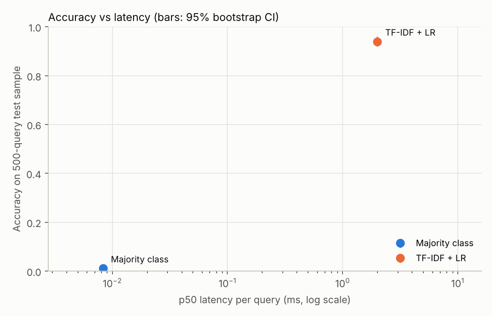

# LLM-or-Not

**The cost–accuracy frontier for customer-intent routing.**

A bank must route each customer message to one of 77 intents. Which approach gives the best
accuracy per rupee and per millisecond, and when is an LLM actually worth it?
The end product is a decision backed by evidence, not a chatbot.

Every number below is written into this file by `scripts/make_report.py` from `results/*.csv`.
Cells that say `[placeholder]` have not been measured yet. Every design choice and the reason for
it is in [DECISIONS.md](DECISIONS.md).

## Results (MVP)

### All methods on the same fixed 500-query test sample

Accuracy and macro-F1 with 95% paired-bootstrap confidence intervals. Latency is per query, one
query at a time. Compute-seconds are converted to rupees only when an hourly machine price is set
in `configs/costs.yaml` ([DECISIONS.md D9](DECISIONS.md)).

<!-- MAIN_TABLE:START -->
| Method | Accuracy (95% CI) | Macro-F1 (95% CI) | Invalid outputs | p50 / p95 latency (ms) | Compute-seconds per 1k queries | INR per 1k queries | Latency measured on |
|---|---|---|---|---|---|---|---|
| Majority class | 0.012 (0.004–0.022) | 0.000 (0.000–0.001) | 0.0% | 0.01 / 0.01 | 0.01 | [placeholder] | Intel(R) Xeon(R) Processor @ 2.80GHz (cpu) |
| TF-IDF + LR | 0.940 (0.920–0.960) | 0.941 (0.914–0.958) | 0.0% | 2.00 / 3.12 | 2.16 | [placeholder] | Intel(R) Xeon(R) Processor @ 2.80GHz (cpu) |
| Sentence embeddings + LR | [placeholder] | [placeholder] | [placeholder] | [placeholder] | [placeholder] | [placeholder] | [placeholder] |
| LLM zero-shot | [placeholder] | [placeholder] | [placeholder] | [placeholder] | [placeholder] | [placeholder] | [placeholder] |
<!-- MAIN_TABLE:END -->



### Does performance survive when near-duplicates are removed?

"Low-overlap" = test messages whose most similar training message has character-n-gram cosine
similarity below 0.90 (see [Data](#data-and-leakage-check)). The LLM is only run on the 500 sample.

<!-- OVERLAP_TABLE:START -->
| Method | Full test (3,080) accuracy | Low-overlap test accuracy | 500 sample accuracy | Low-overlap 500 sample accuracy |
|---|---|---|---|---|
| Majority class | 0.013 (0.009–0.017) n=3080 | 0.014 (0.010–0.019) n=2380 | 0.012 (0.004–0.022) n=500 | 0.011 (0.003–0.021) n=377 |
| TF-IDF + LR | 0.913 (0.904–0.923) n=3080 | 0.897 (0.885–0.908) n=2380 | 0.940 (0.920–0.960) n=500 | 0.928 (0.902–0.952) n=377 |
| Sentence embeddings + LR | [placeholder] | [placeholder] | [placeholder] | [placeholder] |
| LLM zero-shot | n/a (not run on this set) | n/a (not run on this set) | [placeholder] | [placeholder] |
<!-- OVERLAP_TABLE:END -->

Observations (computed by the script):

<!-- OBSERVATIONS:START -->
- TF-IDF + LR: accuracy 0.913 on the full test set vs 0.897 on the low-overlap subset (-1.7 points).
- TF-IDF + LR: accuracy 0.940 on the 500 sample vs 0.913 on the full test set (+2.7 points): a reminder that a 500-item sample has its own luck; compare methods within one set only.
<!-- OBSERVATIONS:END -->

### Error analysis

`scripts/error_analysis.py --method <method>` writes the most-confused intent pairs to
`results/confused_pairs_<method>.csv` and 100 seeded random errors to
`results/error_review_<method>.csv` for hand-tagging as `label_noise` or `model_error`.
Hand-tagging results: [placeholder].

## Data and leakage check

[Banking77](https://huggingface.co/datasets/PolyAI/banking77) (Casanueva et al., 2020, PolyAI),
licence CC BY 4.0: 13,083 customer-service queries, 77 intents, 10,003 train / 3,080 test
(40 per intent in test). Downloaded from PolyAI's original files at a pinned git commit and checked
against SHA-256 hashes (`llmornot/data.py`).

Overlap between train and test (`scripts/check_duplicates.py`). "Exact" means identical after
lowercasing and removing punctuation. "Near" uses cosine similarity of character 3–5-gram TF-IDF
vectors; it ignores word order, so a reworded sentence ("Why was X declined?" / "X was declined,
why?") can score 1.0.

<!-- DUPLICATES:START -->
| Check | Count | Out of | % | Same label (%) |
|---|---|---|---|---|
| `within_train_exact_duplicates` | 10 | 10003 | 0.10 |  |
| `within_train_texts_with_conflicting_labels` | 0 | 9993 | 0.00 |  |
| `within_test_exact_duplicates` | 1 | 3080 | 0.03 |  |
| `within_test_texts_with_conflicting_labels` | 0 | 3079 | 0.00 |  |
| `test_exact_in_train` | 11 | 3080 | 0.36 | 100.0 |
| `test_near_dup_sim_ge_0.95` | 369 | 3080 | 11.98 | 97.0 |
| `test_near_dup_sim_ge_0.90` | 700 | 3080 | 22.73 | 94.7 |
| `test_near_dup_sim_ge_0.80` | 1379 | 3080 | 44.77 | 92.4 |
<!-- DUPLICATES:END -->

## Method

**Splits.** A stratified 10% validation split (1,001 messages) is carved from train. All tuning
(logistic-regression C, LLM model and prompt) happens on validation. The test set is scored once
per final configuration. The LLM is scored on a fixed, seeded, stratified 500-message test sample,
and every other method is scored on the same 500 so the comparison is like-for-like.

**Methods** (all behind one `fit / predict_proba / predict` interface, `llmornot/models/`):

| # | Method | What it is |
|---|---|---|
| 1 | Majority class | Always predicts the most frequent training intent. The floor. |
| 2 | TF-IDF + LR | Word 1–2-gram and character 2–5-gram TF-IDF, multinomial logistic regression. |
| 3 | Sentence embeddings + LR | Frozen `all-MiniLM-L6-v2` sentence vectors, logistic regression. |
| 5 | LLM zero-shot | Local Ollama model; prompt lists the 77 intents (optionally with one-line descriptions); output constrained by JSON schema to the 77 labels; invalid outputs counted. |

After tuning, models 2–3 are refit on train + validation (10,003 messages).

**Metrics.** Accuracy and macro-F1 (each intent weighted equally), with 95% percentile bootstrap
CIs from 2,000 resamples. The same resamples are used for every method (paired).

**Latency.** Wall-clock time per query, one message at a time, after 10 warm-up calls. For the LLM,
the time recorded when each call was made, minus Ollama's one-off model-load time.

**Cost.** Compute-seconds per 1,000 queries; rupees = compute-hours × the hourly machine price in
`configs/costs.yaml`, when set.

**Reproducibility.** Pinned versions in `requirements.txt` (Python 3.11), one seed in
`configs/data.yaml`, prompts under version control in `prompts/`, and every LLM response cached in
`llm_cache/*.jsonl` so `--offline` replays the LLM results without running the model.

## How to reproduce

```bash
python3.11 -m venv .venv && source .venv/bin/activate      # Windows: .venv\Scripts\activate
pip install torch==2.14.1 --index-url https://download.pytorch.org/whl/cu128   # GPU build (optional)
pip install -r requirements.txt && pip install -e .
pytest -q

python scripts/check_duplicates.py              # train/test overlap -> results/duplicates_summary.csv
ollama pull qwen2.5:3b                          # or any candidate in configs/models.yaml
python scripts/tune_llm.py                      # pick LLM model + prompt on validation
python scripts/run_benchmark.py                 # all methods -> results/*.csv + plot
python scripts/error_analysis.py --method tfidf_lr
python scripts/make_report.py                   # rewrite the tables in this README
```

Methods can be run separately (`--methods tfidf_lr embed_lr`); each run replaces only its own rows.
`python scripts/run_benchmark.py --methods llm_zeroshot --offline` replays the cached LLM answers.

## Limitations

- **Latency depends on the machine.** The "measured on" column says where each number came from.
  Numbers from different machines are not directly comparable; for the final comparison, run every
  method on the same machine.
- **Rupee costs need an hourly price.** Local models have no per-token bill. Until a machine price
  is set, the cost column shows compute-seconds only.
- **The 500 sample has its own luck.** Compare methods within the same evaluation set, not across
  sets (see the observations above).
- **The low-overlap subset is not just "harder".** It is the subset of test messages furthest from
  any training sentence by surface form. It may also differ in intent mix and phrasing, so a drop
  there is evidence of reliance on surface overlap, not proof.
- **Zero-shot LLM only, small model.** A 4 GB GPU limits the LLM to ~3-4B parameters. Larger or API
  models could do better; few-shot retrieval (method 6) is Phase 2.
- **The LLM gives no probabilities.** It returns one label, so calibration and abstention
  (Phase 2) need another approach for it.
- **Label descriptions are hand-written** (from label names and training examples, never test),
  and are a design choice that affects the LLM's score.
- **Embedding model revision is not pinned**; it is fetched from Hugging Face by name.

## Repository layout

```
llmornot/          data.py, evaluate.py, costs.py, labels.py, llm_client.py, tuning.py, models/
configs/           data.yaml (seed, splits), models.yaml (grids, LLM settings), costs.yaml (prices)
prompts/           prompt templates + label descriptions
scripts/           check_duplicates, tune_llm, run_benchmark, error_analysis, make_report
results/           CSVs, predictions, plot (generated)
llm_cache/         every LLM response (generated, committed)
tests/             pytest: label parsing, metrics, costs, models, LLM client
```

## Next (Phase 2, not started)

Fine-tuned DistilBERT-size encoder, few-shot LLM with retrieved examples, learning curves,
McNemar tests, calibration and abstention, Pareto plot with recommendations at 1k / 100k / 10M
queries per month, a contamination probe with paraphrased test queries, and a FastAPI service.
